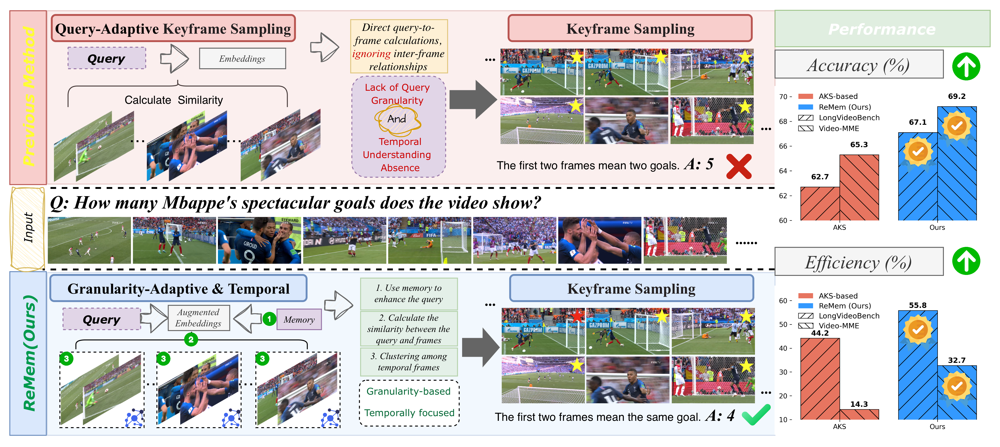
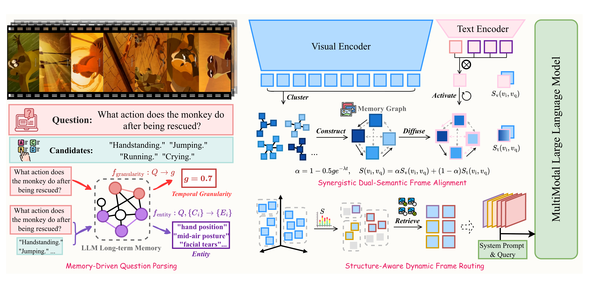

# Reasoning with Memory: A Temporal Granularity-Adaptive Framework for Training-Free Long Video Understanding

[[arXiv](https://arxiv.org/abs/2607.24794)] [[Code](https://github.com/jinlab-imvr/ReMem)]

This repository contains the official implementation of **ReMem**, a training-free keyframe selection framework for zero-shot LongVideoQA.

ReMem is designed for the plug-and-play setting as a keyframe sampling method: before sending a long video to an MLLM, it selects a compact set of informative frames under a fixed visual-token budget. Unlike static query-to-frame selection, ReMem explicitly models the temporal granularity of each question and the structural memory of the video.

## Motivation



Multimodal Large Language Models (MLLMs) demonstrate strong generalization on video tasks, but their restricted context windows make long video understanding difficult. Existing keyframe selection methods usually compare the query with each frame independently. This static query-to-frame matching can retrieve locally relevant frames, but it often overlooks relationships between different moments in the video.

As shown above, different questions require different temporal granularities. Fine-grained questions may only need dense evidence around a short moment, while long-range reasoning questions require frames that preserve event evolution and temporal dependencies. Uniform sampling wastes visual tokens, while purely query-adaptive methods can over-sample redundant frames from a few high-scoring segments.

ReMem addresses this limitation with memory-augmented temporal granularity-adaptive sampling. It uses LLM long-term memory to parse the question, estimates how much temporal context is needed, and then uses video structural memory to route the final frame budget across temporally coherent events.

## Abstract

We propose **ReMem**, a temporal granularity-adaptive keyframe selection framework for training-free LongVideoQA. ReMem introduces a dual-level memory-augmented adaptation mechanism. At the query level, **Memory-Driven Question Parsing** uses an LLM to estimate temporal granularity and extract visual entities from the question and candidate answers. At the video level, **Synergistic Dual-Semantic Frame Alignment** builds a structural memory graph over CLIP frame features, and **Structure-Aware Dynamic Frame Routing** selects temporally coherent, query-relevant keyframes for downstream MLLM reasoning.

Across four LongVideoQA benchmarks and three MLLMs, ReMem achieves strong zero-shot performance. For example, with LLaVA-Video, ReMem reaches **54.5%** on LVBench and **67.1%** on LongVideoBench.

## Method



ReMem contains three main stages:

1. **Memory-Driven Question Parsing**
   - Estimate query temporal granularity with GPT-4o.
   - Extract discriminative visual entities from the question and candidate answers.

2. **Synergistic Dual-Semantic Frame Alignment**
   - Encode questions, entities, and video frames with CLIP.
   - Enhance the query with entity memory.
   - Build a temporal-semantic memory graph over video frames.
   - Fuse static visual-semantic similarity and memory-augmented temporal-semantic similarity.

3. **Structure-Aware Dynamic Frame Routing**
   - Form a candidate frame pool from dual-semantic scores.
   - Cluster candidate frames with TW-FINCH.
   - Allocate the final frame budget across coherent temporal events.
   - Feed the selected frames to an MLLM through `lmms_eval`.

## Installation

Create a Python environment and install the core dependencies:

```bash
conda create -n remem python=3.10
conda activate remem

pip install torch torchvision
pip install transformers openai decord pillow numpy scipy scikit-learn accelerate
```

Set your OpenAI API key before running the question parsing stage:

```bash
export OPENAI_API_KEY="YOUR_OPENAI_API_KEY"
```

## Dataset Preparation

The current code release includes a Video-MME-style example, but the ReMem preprocessing pipeline is the same for other LongVideoQA datasets such as LongVideoBench, MLVU, and LVBench. For a new dataset, prepare an annotation JSON with the same fields, place the videos under a dataset-specific video directory, and update the paths in `frame_select.py`.

For example, Video-MME can be organized as:

```text
VideoMME/
|-- videos/
|   |-- xxx.mp4
|   `-- ...
`-- val_qa.json
```

Each item in the annotation JSON should contain the fields used by `frame_select.py`:

```json
{
  "question_id": "example_id",
  "video_name": "example.mp4",
  "question": "What happens after the person enters the room?",
  "candidates": ["A", "B", "C", "D"],
  "duration": 120.0,
  "granularity": 0.7,
  "entity_keywords": ["person entering room", "doorway", "following action"]
}
```

The `granularity` and `entity_keywords` fields are produced by the query parsing utilities:

- `granularity_analysis.py`: maps each question to a continuous temporal granularity score.
- `entity_extraction.py`: extracts 3-5 visually discriminative entity phrases from the question and answer candidates.

Example usage inside your data preparation script:

```python
import os
from granularity_analysis import classify_question as classify_granularity
from entity_extraction import classify_question as extract_entities

api_key = os.environ["OPENAI_API_KEY"]

granularity = float(classify_granularity(question, api_key))
entity_keywords = extract_entities(question, candidates, api_key)
```

## Frame Selection

Before running frame selection, check the dataset paths in `frame_select.py`:

Using Video-MME as an example:

```python
label_path = "./VideoMME/val_qa.json"
video_root = "./VideoMME/videos"
output_path = "./VideoMME/val_qa_selected.json"
```

Then run:

```bash
python frame_select.py
```

The output JSON will include:

```json
{
  "frame_idx": [0.0, 30.0, 75.0, "..."]
}
```

By default, LLaVA-Video uses a 64-frame budget, while Qwen2-VL and Qwen3-VL use a 32-frame budget in the provided evaluation scripts.

## Evaluation

Evaluation follows the [`lmms_eval`](https://github.com/EvolvingLMMs-Lab/lmms-eval) toolkit.

Install `lmms_eval`:

```bash
git clone https://github.com/EvolvingLMMs-Lab/lmms-eval
cd lmms-eval
pip install -e .
```

Make sure your local `lmms_eval` setup reads the selected `frame_idx` field from the ReMem output annotation when `use_topk=True` is enabled.

Example evaluation scripts are provided under `eval/`.

The scripts evaluate:

- `LLaVA-Video-7B-Qwen2` with 64 selected frames.
- `Qwen2-VL-7B-Instruct` with 32 selected frames.
- `Qwen3-VL-8B-Instruct` with 32 selected frames.

Please update checkpoint paths in the scripts according to your local environment:

```text
./LLaVA-Video-7B-Qwen2
./Qwen2-VL-7B-Instruct
./Qwen3-VL-8B-Instruct
```

## Acknowledgement

This project builds on excellent open-source projects, including [AKS](https://github.com/ncTimTang/AKS), [lmms_eval](https://github.com/EvolvingLMMs-Lab/lmms-eval), thanks for their excellent works.


## Citation

If you find ReMem useful for your research, please consider citing our paper:

```bibtex
@article{meng2026reasoning,
  title={Reasoning with Memory: A Temporal Granularity-Adaptive Framework for Training-Free Long Video Understanding},
  author={Meng, Linghao and Li, Qiankun and Mao, Junyuan and Liao, Pujin and He, Zhicheng and Zhang, Enbo and Wang, Kun and Liu, Yang and Fu, Huazhu and Jin, Yueming},
  journal={arXiv preprint arXiv:2607.24794},
  year={2026},
  note={Accepted by ECCV 2026}
}
```
